# MoE agentic serving benchmark

**How many AI-agent sessions can one 8x H100 node serve on a 235B mixture-of-experts model, and what stops it?**

## Two takeaways

1. **One node serves 64 concurrent agent sessions with every request in target:** first token in 0.85 s and 39 tokens/s per user (p90). That is the highest load we measured that stays in target.
2. **KV cache memory runs out before compute does.** Every turn re-sends a longer conversation, so by 256 sessions the cache is full and at most 14% of requests stay in target. An FP8 KV cache doubles capacity and throughput, the biggest lever measured.

Target: first token within 2 s and at most 50 ms per token, for at least 90% of requests.

> <i>Agent prompts grow every turn, so a load that looks fine early collapses mid-session once the KV cache is full.</i>

> <i>Once histories no longer fit, evicted sessions are prefilled again on their next turn: the node redoes work instead of serving tokens.</i>

> <i>Throughput per GPU and per-user speed trade directly; only the solid points are loads you could run in production.</i>

## Go deeper

| Page | What you get |
|---|---|
| [Results at a glance](docs/results.md) | Every headline number with its conditions, and how it compares with MLPerf limits and InferenceX tiers |
| [Layouts and KV capacity](docs/01-layouts-and-kv-capacity.md) | Which way to split the model across 8 GPUs |
| [The KV cliff](docs/02-load-ladder-and-kv-cliff.md) | Latency from 16 to 1,000 sessions and where it breaks |
| [vLLM vs TensorRT-LLM](docs/03-vllm-vs-tensorrt-llm.md) | Which engine to pick, phase by phase |
| [FP8 KV cache](docs/04-fp8-kv-cache.md) | What it buys and what it does not fix |
| [Prefill/decode split](docs/05-prefill-decode-disaggregation.md) | Whether to split prefill and decode on one node |
| [Sizing](docs/06-operating-frontier-and-sizing.md) | Best configuration per target, sessions to plan per node |
| [Method](docs/00-method.md) · [Limits](docs/08-limits-and-next-measurements.md) · [Glossary](docs/glossary.md) · [Reproduce](docs/reproduce.md) | How it was measured, what it does not show, and how to re-run it |

Related: [moe-disaggregation-benchmark](https://github.com/richajoy/moe-disaggregation-benchmark) (aggregated vs disaggregated serving for MoE models) · [llm-inference-performance](https://github.com/richajoy/llm-inference-performance) (which serving knob moves which metric, from first principles).

## License

[Apache-2.0](LICENSE).
