# 01 Layouts and KV capacity

**What you get from this page:** which way to split a 235B MoE across 8 H100s for agentic serving, how much KV cache each layout leaves, why data-parallel attention loses, and the kernel trap that slows pure tensor parallelism (with a tuned config for it).

## The answer

Use **TP8 attention with EP8 experts** (vLLM: `--tensor-parallel-size 8 --enable-expert-parallel`). Compared with pure TP8 at 64 agentic sessions it cuts TTFT p90 by 30% (1,214 to 851 ms) with the same 100% of requests in target, and it raises prefill-heavy throughput by 19%, for 0.9% less KV. **DP8+EP8 loses on both axes:** 18% less KV (747k tokens) and vLLM's balancer scatters each session's turns across ranks, so TTFT p90 at 64 sessions is 4.53 s and only 42% of requests meet the target. The Dynamo KV router recovers part of that (2.69 s, 64% in target), not all. Layout moves KV capacity by tens of percent; only the KV dtype moves it 2x ([docs/04](04-fp8-kv-cache.md)).

**What a good number is:** the target is TTFT &le; 2 s (the MLPerf conversational limit value) and mean ITL &le; 50 ms for at least 90% of requests ([docs/00](00-method.md#the-target-slo-and-why-these-bounds)). At 64 sessions TP8 and TP8+EP8 meet it with 100%; DP8+EP8 (42%) and DP8+EP8 with the KV router (64%) do not.

## KV capacity by layout

Pool sizes from each engine's startup log ([data/engine-startup.json](../data/engine-startup.json)):

| Layout | Engine | KV dtype | KV pool (tokens) | Weights per GPU | Free KV memory per GPU |
|---|---|---|---|---|---|
| TP8+EP8 | vLLM | FP8 | **1,812,224** | 27.72 GiB | 40.62 GiB |
| TP8 | vLLM | BF16 | 914,240 (relaunch: 914,688) | 27.74 GiB | 40.98 GiB |
| TP8+EP8 | vLLM | BF16 | 906,304 | 27.72 GiB | 40.62 GiB |
| TP8+EP8 | TensorRT-LLM | BF16 | 860,608 | not logged | not logged |
| DP8+EP8 (8 ranks) | vLLM | BF16 | 747,008 (8 x 93,376) | 35.16 GiB | 16.75 GiB |
| P/D decode pool, TP4+EP4 | vLLM | FP8 / BF16 | 587,648 / 294,016 | 55.19 GiB | 13.17 GiB |

> <i>Every BF16 layout holds less than half of what 256 full-length agent sessions need; only FP8 KV comes close.</i>

Why DP8+EP8 holds less: each data-parallel rank stores a full copy of the attention weights (35.16 vs 27.74 GiB per GPU) plus its own CUDA graphs, which leaves 16.75 GiB of KV memory per GPU instead of about 41 GiB. Each rank stores all 4 KV heads for its own requests (188 KiB per token) where TP8 stores one head per GPU (47 KiB per token per GPU), so the totals would match only with equal free memory.

## TP8 vs TP8+EP8

One flag differs (`--enable-expert-parallel`). Cells show **p90** (p50 / p99).

| Point | Metric | TP8 | TP8+EP8 | Change | Like-for-like? |
|---|---|---|---|---|---|
| Agentic, 64 sessions | TTFT | **1,214 ms** (813 / 1,624) | **851 ms** (565 / 1,521) | p90 -30%, p99 -6% | yes, both count-capped |
| Agentic, 64 sessions | ITL | 26.7 ms (22.5 / 29.0) | 25.6 ms (22.3 / 27.6) | p90 -4% | yes |
| Agentic, 64 sessions | tok/s per user (p90) | 37.4 | 39.0 | +4% | yes |
| Agentic, 64 sessions | req/s, output tok/s/GPU | 9.29, 232 | 9.75, 244 | +5% | yes |
| Agentic, 64 sessions | in target | 100% | 100% | | yes |
| S2 (16,384 in / 256 out), 16 concurrent | TTFT | 4.75 s (2.14 / 11.11) | 3.71 s (1.66 / 8.62) | p90 -22% | yes |
| S2, 16 concurrent | ITL | 54.5 ms (53.2 / 57.3) | 45.9 ms (44.8 / 48.1) | p90 -16% | yes |
| S2, 16 concurrent | req/s | 1.00 | 1.19 | +19% | yes |
| Agentic, 256 sessions | TTFT p90, ITL p90 | 17.9 s, 216 ms | 14.0 s, 165 ms | -22%, -24% | **no**: count-capped vs complete |

Sources: `data/vllm-tp8/AG-c64-t8`, `data/vllm-tp8ep8/AG-c64-t8`, `data/vllm-tp8-matrix/S2-c16`, `data/vllm-tp8ep8/S2-c16`, `data/vllm-tp8/AG-c256-t8`, `data/vllm-tp8ep8/AG-c256-t8`.

Most of the gain is in the prefill phase (TTFT, S2 throughput); decode at 64 sessions barely moves. The likely reason is the kernel each layout gets (next section). Expert parallelism also changes MoE communication, and no kernel profile was taken, so the split between the two causes is not measured.

## The TP8 MoE kernel trap

> <i>Slicing every expert 8 ways breaks the FP8 block alignment and silently drops the MoE onto an untuned kernel; whole experts per GPU avoid it.</i>

On pure TP8 each GPU holds a 192-wide slice of every expert (1536 / 8). 192 is not a multiple of the checkpoint's 128-wide FP8 scale blocks, so vLLM re-cuts the scales to [64, 64] blocks. Only vLLM's Triton MoE kernel accepts those, and vLLM 0.31.0 ships no tuned Triton config for `E=128, N=192, fp8_w8a8, block_shape=[64,64]` on H100, so the worker logs `Using default MoE config. Performance might be sub-optimal!`. With EP8 every GPU holds 16 whole experts, the 128-wide blocks stay intact and vLLM picks the FLASHINFER_CUTLASS kernel. The startup logs record this per run (`moe_backend`, `moe_block_refinement` in [data/engine-startup.json](../data/engine-startup.json)). TensorRT-LLM 1.3.0rc29 does not offer MoE tensor parallelism for this checkpoint at all, which is why the engine comparison in [docs/03](03-vllm-vs-tensorrt-llm.md) uses TP8+EP8.

### A tuned MoE config for pure TP8

If you must run pure TP8, a tuned Triton config for this shape helps prefill-heavy load. It is in [deploy/moe-configs/](../deploy/moe-configs/) (use it with `VLLM_TUNED_CONFIG_FOLDER`). Paired single runs on a fresh TP8 launch, identical except for that variable:

| Point | Metric | Default config | Tuned config | Change |
|---|---|---|---|---|
| S2, 16 concurrent | TTFT | 4.78 s (2.14 / 11.14) | 4.09 s (1.83 / 9.53) | p90 -14% |
| S2, 16 concurrent | ITL | 54.5 ms (53.1 / 57.2) | 49.1 ms (48.0 / 51.4) | p90 -10% |
| S2, 16 concurrent | req/s; in target | 1.00; 4% | 1.11; 67% | +11.5% |
| Agentic, 256 sessions (240 s cap, stopped early: 1,905 vs 2,003 turns) | TTFT p90, ITL p90 | 18.1 s, 215 ms | 15.6 s, 186 ms | -14%, -14% |
| Agentic, 256 sessions | req/s | 7.38 | 7.99 | +8% |
| Agentic, 64 sessions | TTFT | 1,230 ms (841 / 1,842) | **2,026 ms** (816 / 3,096) | p90 **+65%** |
| Agentic, 64 sessions | req/s; in target | 9.26; 100% | 8.92; 87.5% | -4% |
| GSM8K, first 400 test questions | accuracy | 94.50% (378) | 94.75% (379) | no change (1 question) |

Sources: `data/vllm-tp8-moe-default/*`, `data/vllm-tp8-moe-tuned/*`, [data/accuracy.json](../data/accuracy.json).

The 64-session regression is concentrated in a few turns and was not repeated, so its cause is unknown. Even tuned, pure TP8 trails TP8+EP8 on the prefill-heavy point (1.11 vs 1.19 req/s, TTFT p90 4.09 vs 3.71 s), so the layout recommendation does not change.

## DP8+EP8: session scatter and the KV router

With data-parallel attention each rank has its own KV cache. vLLM's internal balancer places requests by load, not by cached prefix, so a session's turns land on ranks that never saw its history.

| 64 sessions | TP8 (reference) | DP8+EP8, vLLM balancer | DP8+EP8, Dynamo KV router |
|---|---|---|---|
| TTFT | **1,214 ms** (813 / 1,624) | **4,534 ms** (2,171 / 5,794) | **2,687 ms** (1,532 / 3,422) |
| ITL | **26.7 ms** (22.5 / 29.0) | **41.4 ms** (28.2 / 52.5) | **36.6 ms** (28.1 / 42.0) |
| tok/s per user (p90) | 37.4 | 24.1 | 27.3 |
| prefix-cache hit (ideal 88.9%) | 88.4% | 49.2% | 70.0% |
| in target / goodput per GPU | 100% / 1.16 | 42% / 0.32 | 64% / 0.55 |
| req/s | 9.29 | 6.05 | 6.89 |
| KV peak | 0.37 | 0.51 | 0.51 |

At 256 sessions both DP8+EP8 variants are full (KV peak 1.00, hit 37.6% and 40.4%, TTFT p90 20.3 s and 20.7 s): routing cannot help once the cache cannot hold the sessions. All six points are count-capped, so they compare like-for-like. Sources: `data/vllm-tp8/`, `data/vllm-dp8ep8/`, `data/vllm-dp8ep8-kvrouter/`.

> <i>On data-parallel ranks a prefix-blind balancer throws away the agent's cached history; a KV-aware router keeps most of it.</i>

The gap from 70% to the 88.9% ideal is routing, not capacity: the KV peak was only 0.51. The router balances cached overlap against load; its weighting was not tuned here. The router needs KV events enabled on the worker (`--kv-events-config`); without them it cannot see which rank holds which blocks.

## What to do with it

- **Default layout for this model on one node: TP8 attention + EP8 experts.** It holds as much KV as TP8, runs the faster MoE kernel and gives the best measured agentic TTFT.
- **Avoid data-parallel attention for agents on one node** unless you need it for other reasons; if you use it, use the Dynamo KV router with KV events on, and expect less KV per GPU.
- **If you are stuck on pure TP8** with this checkpoint on vLLM 0.31.0, check the worker log for `Using default MoE config`; the tuned config in `deploy/moe-configs/` lifts prefill-heavy throughput by about 11%, but test your own concurrency first because one agentic point got worse.
- **Do not expect layout to fix capacity.** The spread between layouts is tens of percent; agents at 256 sessions need about 2x the KV any BF16 layout holds ([docs/04](04-fp8-kv-cache.md)).
