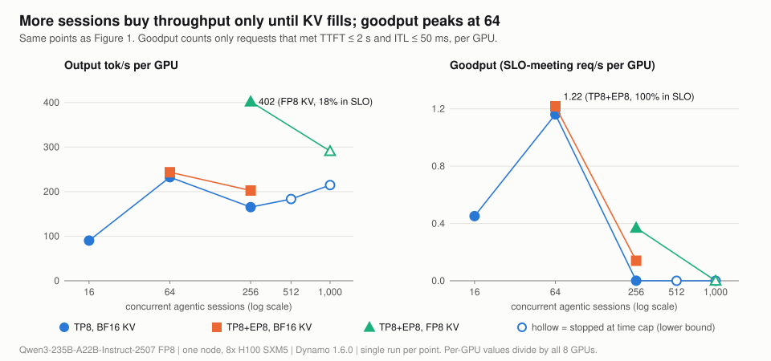
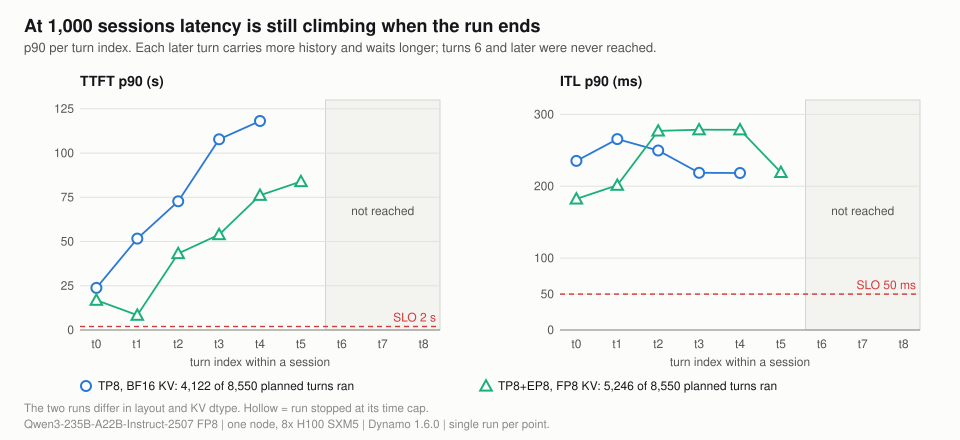

# 02 Load ladder and the KV cliff

**What you get from this page:** how latency and throughput change from 16 to 1,000 concurrent agent sessions on one node, where the curve breaks, why it breaks (the KV cliff), how longer sessions move the break, and fixed-shape baselines for context.

## The answer

Agentic load is healthy up to **64 sessions** and breaks by **256**. On vLLM TP8 with BF16 KV, 64 sessions run with TTFT p90 1.21 s, ITL p90 26.7 ms and every request in target; at 256 sessions the 914k-token KV pool is full, the prefix-cache hit falls from 88% to 52%, TTFT p90 rises 15x to 17.9 s, ITL p90 8x to 216 ms, and throughput **falls** below the 64-session level (6.61 vs 9.29 req/s). Past that point more sessions buy nothing: 1,000 sessions deliver 8.59 req/s with TTFT p90 of at least 99 s. The break is a capacity cliff, not a slow kernel: it appears mid-session, at turn 4 to 5, when growing conversations no longer fit.

**What a good number is:** the target is TTFT &le; 2 s (the MLPerf conversational limit value) and mean ITL &le; 50 ms (20 tok/s per user) for at least 90% of requests ([docs/00](00-method.md#the-target-slo-and-why-these-bounds)). Every 64-session point in the table below meets it with 100%; no point at 256 or more reaches 20%.

## The ladder

> <i>The knee sits between 64 and 256 sessions on every layout; past it TTFT grows by orders of magnitude while throughput stays flat.</i>

vLLM TP8, BF16 KV unless marked. Cells show **p90** (p50 / p99).

| Sessions | Completion | TTFT | ITL | tok/s per user (p90) | req/s | output tok/s/GPU | in target | prefix hit (ideal) | KV peak | preemptions | waiting p90 |
|---|---|---|---|---|---|---|---|---|---|---|---|
| 16 (4-turn) | count-capped, 256 of 301 | **450 ms** (275 / 1,292) | **19.3 ms** (16.5 / 20.9) | 51.8 | 3.61 | 90 | 100% | 84.0% (84.2%) | 0.06 | 0 | 0 |
| 64 | count-capped, 512 of 572 | **1,214 ms** (813 / 1,624) | **26.7 ms** (22.5 / 29.0) | 37.4 | 9.29 | 232 | 100% | 88.4% (88.9%) | 0.37 | 0 | 4 |
| 256 | count-capped, 2,048 of 2,208 | **17.9 s** (4.8 / 38.0) | **216 ms** (74 / 218) | 4.6 | 6.61 | 165 | 0.05% | 52.0% (88.9%) | 1.00 | 22 | 113 |
| 512 | stopped at time cap, 3,179 of 4,367 | **62.6 s** (28.0 / 70.7) | **217 ms** (214 / 221) | 4.6 | 7.33 | 183 | 0% | 45.9% (88.9%) | 1.00 | 51 | 277 |
| 1,000 | stopped at time cap, 4,122 of 8,550 | **99.3 s** (50.9 / 117.1) | **265 ms** (230 / 269) | 3.8 | 8.59 | 215 | 0% | 50.8% (88.9%) | 1.00 | 108 | 701 |
| 64, TP8+EP8 | count-capped | **851 ms** (565 / 1,521) | **25.6 ms** (22.3 / 27.6) | 39.0 | 9.75 | 244 | 100% | 88.2% | 0.37 | 0 | 0 |
| 256, TP8+EP8 | complete, 2,208 | **14.0 s** (3.3 / 28.4) | **165 ms** (57 / 166) | 6.1 | 8.10 | 203 | 14% | 57.0% | 1.00 | 20 | 95 |
| 256, TP8+EP8, FP8 KV | complete, 2,208 | **4.10 s** (2.06 / 5.31) | **56.4 ms** (45.1 / 61.1) | 17.7 | 16.08 | 402 | 18% | 89.0% | 0.70 | 0 | 106 |
| 1,000, TP8+EP8, FP8 KV | stopped at time cap, 5,246 of 8,550 | **72.5 s** (21.0 / 83.3) | **278 ms** (257 / 280) | 3.6 | 11.64 | 291 | 0% | 51.5% | 1.00 | 9 | 549 |

Sources: `data/vllm-tp8/AG-*`, `data/vllm-tp8-matrix/AG-*`, `data/vllm-tp8ep8/AG-*`, `data/vllm-tp8ep8-fp8kv/AG-*`. The 512- and 1,000-session rows stopped at their time cap while later, slower turns were still pending, so their latencies are **lower bounds**.

> <i>Throughput per GPU is not the number to optimize for agents: the goodput peak is at 64 sessions, and past the cliff extra sessions add queueing, not output.</i>

## Why it breaks: the KV cliff

> <i>Once agent histories no longer fit, every evicted session must be prefilled again on its next turn, so the node spends its time redoing work instead of serving new tokens.</i>

The chain, in order:

1. **Sessions grow.** Each turn re-sends the whole conversation, so a session's prompt grows from 2,601 tokens at turn 0 to 8,207 at turn 7 (measured medians). 256 sessions at full length need about 1.6M to 2.2M tokens of KV against a 0.91M pool.
2. **The pool fills.** KV peak is 1.00 from 256 sessions up on every BF16 layout.
3. **Cached history is evicted.** Prefix hit drops from 88% (at the ideal) to 46 to 52%. Preemptions (22 to 108 per point) are the smaller effect; most of the loss is idle sessions' cached prefixes evicted between turns.
4. **Evicted history is prefilled again** on the next turn, adding prefill work.
5. **Requests queue.** Waiting p90 goes 4 &rarr; 113 &rarr; 277 &rarr; 701 from 64 to 1,000 sessions, and TTFT follows the queue.
6. **Decode slows.** Each engine step carries the running decodes plus up to 8,192 prefill tokens, so ITL p90 climbs from 27 ms to 216 to 265 ms.

The cliff is visible inside a single run. At 256 sessions on TP8+EP8 with BF16 KV, TTFT p90 stays near 4 s for turns 0 to 3, then rises to 8.8 s at turn 4 and 28.4 s at turn 5, and ITL p90 jumps from 61 to 159 ms between turns 3 and 4. With FP8 KV (twice the pool) on the same layout neither jumps:

> <i>A load test that stops after a few turns would miss this cliff entirely; agent capacity has to be measured over whole sessions.</i>

### 1,000 sessions: still climbing when the run ended

> <i>The 1,000-session numbers are a floor, not a measurement of steady state: every later turn waited longer and the run ended before the slowest turns.</i>

Both 1,000-session runs stopped at their 360 s cap (plus 120 s grace) after 48% and 61% of planned turns, having reached only turn 4 and turn 5. Per-turn TTFT p90 rose on every turn and never levelled off, so whole-run percentiles at 1,000 sessions are lower bounds. The two runs also differ in layout **and** KV dtype, so their difference is not an FP8 effect size.

## Longer sessions move the cliff closer

Same TP8 server, 64 sessions, 8 vs 20 turns per session:

| 64 sessions | 8 turns (count-capped, 512 of 572) | 20 turns (complete, 1,378) |
|---|---|---|
| TTFT | 1,214 ms (813 / 1,624) | 1,249 ms (777 / 1,483) |
| ITL | 26.7 ms (22.5 / 29.0) | 33.1 ms (27.0 / 37.0) |
| tok/s per user (p90) | 37.4 | 30.2 |
| req/s / output tok/s per GPU | 9.29 / 232 | 6.52 / 163 |
| in target | 100% | 100% |
| prefix hit (ideal) | 88.4% (88.9%) | 94.4% (94.1%) |
| KV peak | 0.37 | 0.85 |

Twenty-turn sessions still meet the target at 64, but they use 85% of the pool against 37%, and throughput falls 30% because each turn carries more context. Longer agent sessions lower the session count at which the cliff arrives. The two points use different completion rules, so treat the deltas as directional.

## Fixed-shape baselines (TP8)

For context against the usual single-turn shapes. Cells show **p90** (p50 / p99).

| Point | TTFT | ITL | tok/s per user (p90) | req/s | output tok/s/GPU | in target | KV peak |
|---|---|---|---|---|---|---|---|
| S1 (512 / 4,096), 16 concurrent | 497 ms (465 / 498) | 14.8 ms (14.7 / 14.9) | 67.6 | 0.24 | 125 | 100% | 0.08 |
| S1, 64 concurrent | TTFT not valid (prompt reuse) | 19.5 ms (19.5 / 19.9) | 51.2 | 0.66 | 336 | 99% | 0.33 |
| S1, 256 concurrent | TTFT optimistic (prompt reuse) | 47.8 ms (43.0 / 49.0) | 20.9 | 1.25 | 638 | 68% | 1.00 |
| S2 (16,384 / 256), 16 concurrent | 4.75 s (2.14 / 11.11) | 54.5 ms (53.2 / 57.3) | 18.3 | 1.00 | 32 | 3% | 0.29 |
| S2, 64 concurrent | 38.7 s (10.0 / 50.2) | 169 ms (162 / 169) | 5.9 | 1.19 | 38 | 0% | 1.00 |
| S2, 256 concurrent | 171.8 s (86.9 / 188.7) | 172 ms (169 / 172) | 5.8 | 1.30 | 42 | 0% | 1.00 |
| S3 (16,384 / 4,096), 16 concurrent | 4.40 s (2.13 / 10.81) | 21.4 ms (21.3 / 21.6) | 46.7 | 0.17 | 87 | 18% | 0.36 |

Source: `data/vllm-tp8-matrix/S*`. The S1 runs drew prompts from a small synthetic pool (prefix hit 98.5% at 64 concurrent), so their TTFT does not reflect a cold prefill. The highest per-GPU output in the whole dataset, 638 tok/s at S1 with 256 concurrent, is a decode-bound single-turn shape at 68% in target: not an agentic number.

What the fixed shapes say: 16k-token prompts miss the target even at 16 concurrent on pure TP8 (prefill-bound at about 16k to 19k prompt tokens per second on pure TP8, at most about 20k on any layout measured), while long outputs with short prompts are comfortable. Agentic load sits between the two: its prompts are long but mostly cached.

## What to do with it

- **Size agent capacity by whole sessions, not by single requests.** Test until the longest sessions finish; the cliff appears at turn 4 to 5 at 256 sessions here.
- **Plan around 64 concurrent sessions per node** for this model and target on BF16 KV. 96 to 192 sessions were not measured, so the real limit is between 64 and 256 and may be higher.
- **Watch KV usage and prefix hit, not GPU utilization.** KV peak near 1.00 and a hit rate falling below the session-length ideal are the early signs of the cliff.
- **Do not chase concurrency past the knee.** From 256 to 1,000 sessions throughput barely moves and on TP8 with BF16 KV at most 0.05% of requests meet the target.
