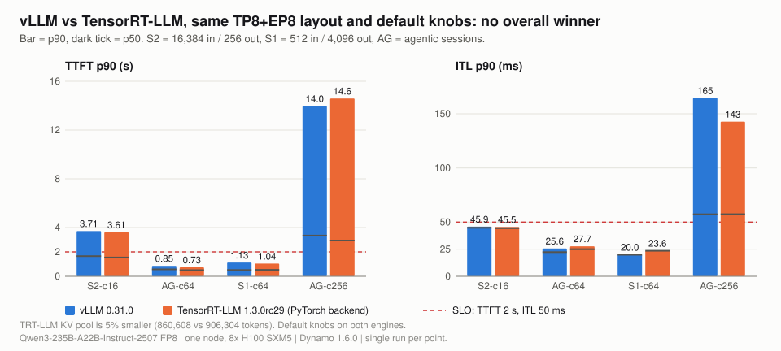

# 03 vLLM vs TensorRT-LLM

**What you get from this page:** whether to pick vLLM 0.31.0 or TensorRT-LLM 1.3.0rc29 behind Dynamo 1.6.0 for this model, phase by phase, at the same TP8+EP8 layout and default settings, and which TensorRT-LLM settings were not tried.

## The answer

**Neither engine wins overall at default settings.** TensorRT-LLM has a lower TTFT p90 on three of four points (-3% to -14%) and higher TTFT p90 on the fourth (+4% at 256 sessions). vLLM streams faster at light load (TensorRT-LLM ITL p90 +8% at 64 agentic sessions, +18% on long outputs) and delivers 8% more agentic throughput at 64 sessions. Under KV pressure at 256 sessions they tie on throughput (8.26 vs 8.10 req/s), with TensorRT-LLM using a 5% smaller KV pool. Every point is a single run, so gaps under about 10% are noise. Pick on operational grounds (metrics, startup, features) unless you tune TensorRT-LLM's MoE backend, which was not tried here.

**What a good number is:** the target is TTFT &le; 2 s and mean ITL &le; 50 ms for at least 90% of requests ([docs/00](00-method.md#the-target-slo-and-why-these-bounds)). Both engines meet it at 64 agentic sessions (100%) and on S1 at 64 concurrent (vLLM 100%, TensorRT-LLM 98%); neither does on S2 (86%) or at 256 sessions (17% or less).

## Why TP8+EP8 for both

TensorRT-LLM 1.3.0rc29 does not run MoE tensor parallelism for this FP8 checkpoint (each GPU's 192-wide expert slice is not a multiple of its 128-wide FP8 block; see [docs/01](01-layouts-and-kv-capacity.md#the-tp8-moe-kernel-trap)), so the like-for-like layout is TP8 attention + EP8 experts on both engines.

| | vLLM 0.31.0 | TensorRT-LLM 1.3.0rc29 |
|---|---|---|
| Worker | `dynamo.vllm ... --tensor-parallel-size 8 --enable-expert-parallel` | `dynamo.trtllm --extra-engine-args trtllm-tp8ep8.yaml --publish-kv-events --publish-metrics` |
| Engine settings | base vLLM settings ([docs/00](00-method.md#engine-settings)) | [deploy/trtllm-tp8ep8.yaml](../deploy/trtllm-tp8ep8.yaml): PyTorch backend, `max_num_tokens 8192`, block reuse on, 64-token blocks, CUDA graphs to batch 512, overlap scheduler on |
| MoE kernel | FLASHINFER_CUTLASS | MoE backend AUTO (default) |
| Admission under KV pressure | preempts and recomputes | `GUARANTEED_NO_EVICT` (queues instead) |
| KV pool | 906,304 tokens | 860,608 tokens (-5%) |
| Frontend | `dynamo.frontend --router-mode round-robin --kv-cache-block-size 64` | same |

## Results

Same four points in the same order on both engines. Cells show **p90** (p50 / p99).

| Point | Engine | TTFT | ITL | tok/s per user (p90) | req/s | output tok/s/GPU | in target |
|---|---|---|---|---|---|---|---|
| S2 (16,384 / 256), 16 concurrent | vLLM | **3.71 s** (1.66 / 8.62) | **45.9 ms** (44.8 / 48.1) | 21.8 | 1.19 | 38 | 86% |
| | TensorRT-LLM | **3.61 s** (1.54 / 8.16) | **45.5 ms** (44.4 / 46.7) | 22.0 | 1.21 | 39 | 86% |
| Agentic, 64 sessions | vLLM | **851 ms** (565 / 1,521) | **25.6 ms** (22.3 / 27.6) | 39.0 | 9.75 | 244 | 100% |
| | TensorRT-LLM | **733 ms** (499 / 1,329) | **27.7 ms** (25.0 / 29.8) | 36.1 | 8.98 | 225 | 100% |
| S1 (512 / 4,096), 64 concurrent | vLLM | **1,126 ms** (513 / 1,129) | **20.0 ms** (19.9 / 33.6) | 50.1 | 0.64 | 325 | 100% |
| | TensorRT-LLM | **1,039 ms** (524 / 1,042) | **23.6 ms** (23.6 / 50.4) | 42.4 | 0.55 | 277 | 98% |
| Agentic, 256 sessions | vLLM | **14.0 s** (3.34 / 28.4) | **165 ms** (57 / 166) | 6.1 | 8.10 | 203 | 14% |
| | TensorRT-LLM | **14.6 s** (2.93 / 23.3) | **143 ms** (57 / 143) | 7.0 | 8.26 | 207 | 17% |

Sources: `data/vllm-tp8ep8/*`, `data/trtllm-tp8ep8/*`. Completion: S1 and S2 100 requests each with unique prompts; agentic 64 sessions count-capped at 512 turns; agentic 256 sessions complete (2,208 turns) on both.

> <i>TensorRT-LLM tends to win first-token latency and vLLM wins token streaming at light load, so the right engine depends on which half of the target binds.</i>

TensorRT-LLM relative to vLLM:

| Point | TTFT p90 | ITL p90 | req/s | Read |
|---|---|---|---|---|
| S2, 16 concurrent | -3% | -1% | +1% | tie |
| Agentic, 64 sessions | **-14%** | **+8%** | **-8%** | TensorRT-LLM faster to first token, vLLM faster per token and more throughput |
| S1, 64 concurrent | -8% | **+18%** | **-14%** | vLLM decodes faster on long outputs |
| Agentic, 256 sessions | +4% (p99 -18%) | -13% | +2% | tie on throughput; TensorRT-LLM's tail is tighter while queueing instead of preempting |

Prefix reuse is equal at 64 sessions (88.7% of blocks vs 88.2% of tokens, ideal 88.9%); the two engines count it in different units, so small hit differences are not engine behavior.

## What was not tried

None of these were run; each could change the verdict:

- TensorRT-LLM MoE backend override (`moe_config.backend`: DEEPGEMM or CUTLASS instead of AUTO), the first suspect for its slower decode.
- TensorRT-LLM attention data parallelism with EP8 (config prepared in [deploy/trtllm-dp8ep8-not-measured.yaml](../deploy/trtllm-dp8ep8-not-measured.yaml)).
- FP8 KV cache on TensorRT-LLM (doubles its pool, as it did for vLLM).
- CUDA graph batch sizes, overlap scheduler off, `max_num_tokens` other than 8,192.
- vLLM served directly instead of behind the Dynamo frontend, so frontend overhead is unmeasured on both.

## What to do with it

- **If your binding constraint is first-token latency at moderate load**, TensorRT-LLM at default settings gave 14% lower TTFT p90 at 64 sessions; confirm with repeats before switching, since the gap is close to the noise band.
- **If it is streaming speed or throughput at moderate load**, vLLM was ahead (ITL p90 -8%, +8% agentic throughput, +17% on long outputs).
- **Under KV pressure neither engine fixes the problem**: at 256 sessions both serve under 20% of requests within target. Fix capacity first ([docs/04](04-fp8-kv-cache.md)).
- **Operationally**, vLLM exported preemption and queue gauges that TensorRT-LLM did not, which matters for diagnosing the KV cliff.
