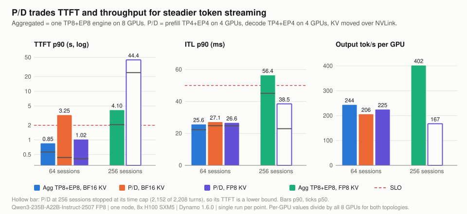
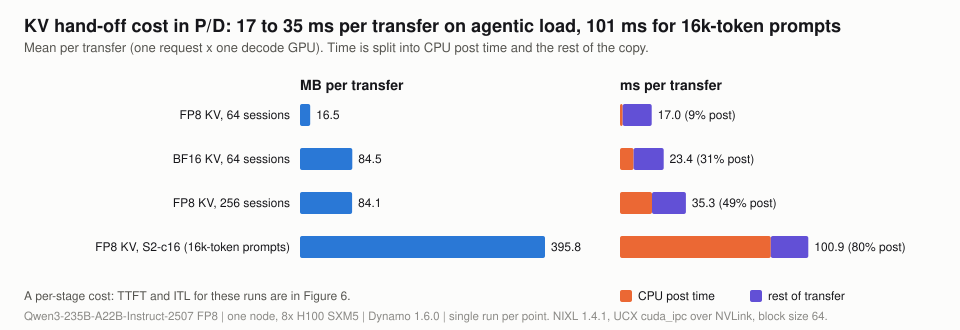

# 05 Prefill/decode disaggregation

**What you get from this page:** whether to split one 8-GPU node into a prefill worker and a decode worker (P/D) for agentic load on this model, what it trades, why, and what the KV hand-off between the two costs.

## The answer

**Keep this model aggregated on one node for agentic serving.** The only split that fits, one prefill worker (TP4+EP4 on GPUs 4-7) and one decode worker (TP4+EP4 on GPUs 0-3), keeps token streaming steady under load but loses on first-token latency and throughput. At 256 sessions with FP8 KV on both sides, P/D cuts ITL p90 from 56.4 to 38.5 ms, but TTFT p90 rises at least 11x (4.1 to 44.4 s, a lower bound because the P/D run stopped at its time cap) and output falls from 402 to 167 tok/s per GPU. The cause is capacity on both sides: a TP4 copy of the 235B model leaves the decode worker only 588k FP8 KV tokens (a third of the aggregated pool), and prefill has only 4 GPUs, so both pools evict session history. At 64 sessions the two are close; P/D with FP8 KV has the lowest median TTFT of any 64-session point (409 ms) but a worse p90 and 8% less throughput than aggregated with BF16 KV (a comparison that changes both topology and KV dtype).

**What a good number is:** the target is TTFT &le; 2 s and mean ITL &le; 50 ms for at least 90% of requests ([docs/00](00-method.md#the-target-slo-and-why-these-bounds)). P/D meets it only at 64 sessions with FP8 KV (99.6% in target); with BF16 KV at 64 sessions it reaches 86%, and at 256 sessions 27%.

## Configuration

| | Decode worker | Prefill worker |
|---|---|---|
| GPUs | 0-3 | 4-7 |
| Parallelism | TP4 + EP4 | TP4 + EP4 |
| Role | NixlConnector `kv_consumer`, `--max-num-seqs 512` | NixlConnector `kv_producer`, `--max-num-seqs 256` |
| KV pool, FP8 / BF16 | 587,648 / 294,016 tokens | 602,112 / 301,184 tokens |
| Weights per GPU | 55.19 GiB | 55.19 GiB |

Common: block size 64, prefix caching on, `UCX_TLS=cuda_ipc,cuda_copy,tcp` so KV moves GPU to GPU over NVLink. Launch: [scripts/serve/launch-pd.sh](../scripts/serve/launch-pd.sh). An FP8 235B model needs at least 4 GPUs per worker, so 1P:1D is the only split one 8-GPU node allows.

## Results

Cells show **p90** (p50 / p99). Output tok/s per GPU divides by all 8 GPUs in every row, for both topologies.

| Point | Topology, KV | TTFT | ITL | tok/s per user (p90) | req/s | output tok/s/GPU | in target | prefix hit |
|---|---|---|---|---|---|---|---|---|
| Agentic, 64 | aggregated TP8+EP8, BF16 | **851 ms** (565 / 1,521) | **25.6 ms** (22.3 / 27.6) | 39.0 | 9.75 | 244 | 100% | 88.2% |
| Agentic, 64 | P/D, BF16 | **3,251 ms** (436 / 4,911) | **27.1 ms** (24.8 / 28.1) | 36.9 | 8.22 | 206 | 86% | 71.4% |
| Agentic, 64 | P/D, FP8 | **1,022 ms** (409 / 1,983) | **26.6 ms** (24.8 / 27.1) | 37.6 | 8.99 | 225 | 99.6% | 86.6% |
| Agentic, 256 | aggregated TP8+EP8, FP8 | **4.10 s** (2.06 / 5.31) | **56.4 ms** (45.1 / 61.1) | 17.7 | 16.08 | 402 | 18% | 89.0% |
| Agentic, 256 (stopped at time cap) | P/D, FP8 | **44.4 s**, lower bound (24.3 / 46.1) | **38.5 ms** (23.0 / 40.2) | 26.0 | 6.70 | 167 | 27% | 39.9% |
| S2 (16,384 / 256), 16 | aggregated TP8+EP8, BF16 | **3.71 s** (1.66 / 8.62) | **45.9 ms** (44.8 / 48.1) | 21.8 | 1.19 | 38 | 86% | n/a |
| S2, 16 | P/D, FP8 | **8.13 s** (7.98 / 12.17) | **17.1 ms** (17.0 / 17.1) | 58.5 | 1.23 | 40 | 1% | n/a |

Sources: `data/vllm-tp8ep8/*`, `data/vllm-tp8ep8-fp8kv/AG-c256-t8`, `data/vllm-pd-1p1d/AG-c64-t8`, `data/vllm-pd-1p1d-fp8kv/*`.

Which comparisons are clean: agentic 64 with BF16 on both sides (both count-capped) and agentic 256 with FP8 on both sides change one variable, the topology. At 256 the P/D run stopped at its time cap after 2,152 of 2,208 turns while the aggregated run finished, so P/D's TTFT is a lower bound and its rate is a capped-window rate; P/D is slower either way. Rows that pair aggregated BF16 with P/D FP8 change two variables.

> <i>On one node, P/D moves the wait from the token stream to the first token and pays for it with more than half the throughput.</i>

> <i>Separating decode from prefill keeps steps short, but four prefill GPUs cannot keep up with 256 growing sessions, so the queue moves to the front of every request.</i>

## Why P/D loses here

- **Decode is KV-starved.** 587,648 FP8 tokens on the decode worker vs 1,812,224 aggregated. The decode pool's hit falls to 39.8% at 256 sessions (aggregated: 89.0%), so most of each session's history is pulled again.
- **Prefill is compute-starved.** 4 GPUs prefill for 256 growing sessions; the waiting queue p90 is 207 (aggregated 106).
- **Both pools evict.** Per-pool prefix hit at 256 sessions: decode 39.8%, prefill 40.1%. At 64 sessions with FP8 KV: decode 88.2%, prefill 85.1%. With BF16 KV at 64 the decode pool is already full (KV peak 1.00, hit 68.7%).
- **Light-load decode is slower on TP4.** At 64 sessions ITL p50 is 24.8 ms on P/D vs 22.3 ms aggregated; P/D's ITL advantage only appears once the aggregated engine starts mixing large prefill chunks into decode steps (256 sessions, S2).
- **FP8 KV helps inside P/D too** (64 sessions, single variable): TTFT p90 3,251 to 1,022 ms, in target 86% to 99.6%, req/s +9%, decode KV peak 1.00 to 0.53.

## KV hand-off cost

Per-transfer means from the decode worker's NIXL histograms; one transfer is one request's KV for one of the 4 decode GPUs ([data/nixl.json](../data/nixl.json)). These are per-stage costs; the end-to-end TTFT and ITL for the same runs are in the table above.

| Point | Transfers | MB per transfer | ms per transfer | of which CPU post time | descriptors per transfer | failed |
|---|---|---|---|---|---|---|
| FP8 KV, agentic 64 | 2,048 | 16.5 | 17.0 | 1.4 ms (9%) | 155 | 0 |
| BF16 KV, agentic 64 | 2,048 | 84.5 | 23.4 | 7.3 ms (31%) | 1,784 | 0 |
| FP8 KV, agentic 256 | 8,608 | 84.1 | 35.3 | 17.2 ms (49%) | 4,718 | 0 |
| FP8 KV, S2 16 (16k-token prompts) | 400 | 395.8 | 100.9 | 80.8 ms (80%) | 23,151 | 0 |

> <i>The KV copy is not the bottleneck on one node, but its CPU-side cost grows faster than its size, so it gets worse exactly when load is high.</i>

A transfer moves 1 to 4 GB/s of payload on links that carry hundreds of GB/s, and CPU post time grows from 9% to 80% of each transfer as descriptor counts rise. That pattern fits a cost dominated by per-descriptor CPU work rather than bandwidth; payload and descriptor count grow together here, so the two are not separated. At S2 the 101 ms transfer is small next to an 8 s TTFT, which is prefill queueing on 4 GPUs.

## What to do with it

- **Do not split this model across one 8-GPU node for agents.** Aggregated TP8+EP8 with FP8 KV gives 2.4x the throughput and 1.6x the goodput at 256 sessions (P/D measured over a run that stopped at its time cap).
- **P/D is worth it only if smooth streaming under load is the binding target** and you can accept a TTFT of tens of seconds, or if you can give prefill and decode more GPUs (multi-node), which was not measured here. The sibling benchmark [moe-disaggregation-benchmark](https://github.com/richajoy/moe-disaggregation-benchmark) covers prefill/decode disaggregation for MoE models in more depth.
- **If you run P/D, use FP8 KV on the decode side** and watch the decode pool's KV peak and prefix hit; a full decode pool turns every turn into a full history transfer.
