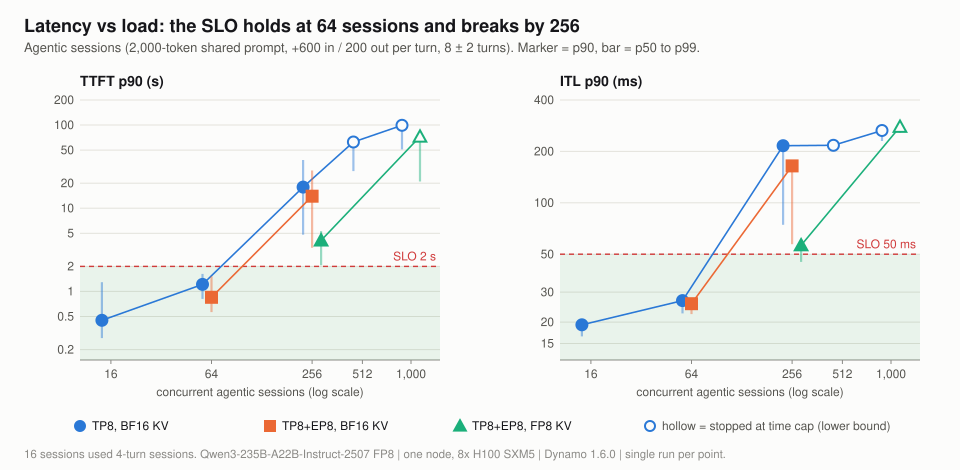
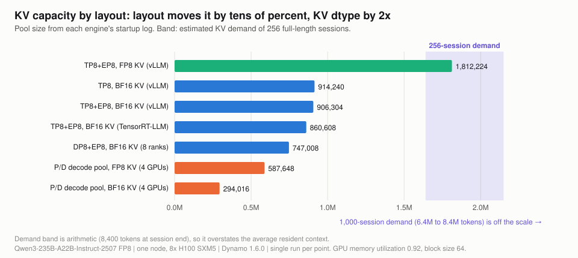
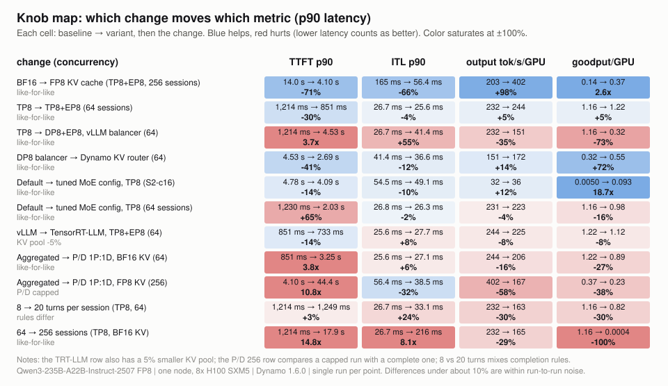

# Results at a glance

Every headline number in one place, with its conditions. Back to the [overview](../README.md).

Every number on this page is one run on one node: Qwen3-235B-A22B-Instruct-2507 (FP8 weights), 8x H100 SXM5, NVIDIA Dynamo 1.6.0. The agentic workload re-sends a growing conversation each turn: a 2,000-token shared system prompt, +600 new input tokens and 200 output tokens per turn, 8 &plusmn; 2 turns per session, a 1 s tool gap between turns. The prompt grows from **2,600 tokens at turn 0 to 8,200 at turn 7**. Terms are defined in the [glossary](glossary.md).

## Headline results

Percentiles lead with p90. Cells show **p90** (p50 / p99). "tok/s per user" is 1000 / ITL p90, the speed of the slowest 10% of streams. A request is in target when its TTFT is at most 2 s and its mean ITL at most 50 ms; a load meets the target when at least 90% of its requests are in target.

| Question | Answer | Conditions |
|---|---|---|
| Highest load measured that meets the target (&ge; 90% of requests with TTFT &le; 2 s and ITL &le; 50 ms) | **64 sessions**, 100% in target: TTFT **851 ms** (565 / 1,521), ITL **25.6 ms** (22.3 / 27.6), 39.0 tok/s per user, 9.75 req/s, 244 output tok/s/GPU, goodput 1.22 req/s/GPU | vLLM TP8+EP8, BF16 KV, 512 of 572 planned turns (count-capped); 96 to 192 sessions not run |
| Where it breaks | **KV cache capacity, from 256 sessions on BF16 KV**: KV pool 100% full, prefix-cache hit 88% &rarr; 52%, TTFT **17.9 s** (4.8 / 38.0), ITL **216 ms** (74 / 218), 0.05% of requests in target | vLLM TP8, BF16 KV (914,240-token pool), count-capped |
| Largest single lever | **FP8 KV cache**: pool 906,304 &rarr; 1,812,224 tokens; at 256 sessions output 203 &rarr; 402 tok/s/GPU, TTFT p90 14.0 &rarr; 4.1 s, ITL p90 164.6 &rarr; 56.4 ms, goodput 0.14 &rarr; 0.37 | vLLM TP8+EP8; both runs finished all 2,208 turns; same flags apart from KV dtype; FP8 scale uncalibrated |
| 1,000 sessions | **0% in target on both configurations run.** Best: TTFT **72.5 s** (21.0 / 83.3), ITL **278 ms** (257 / 280) | TP8+EP8, FP8 KV; stopped at its time cap after 61% of turns, so latencies are lower bounds |
| Best layout | **TP8 attention + EP8 experts**: TTFT p90 1,214 &rarr; 851 ms vs pure TP8 at 64 sessions (-30%); prefill-heavy throughput +19% | same vLLM command plus one flag |
| vLLM vs TensorRT-LLM | **No overall winner** at default knobs: TRT-LLM TTFT p90 -14% at 64 sessions, ITL p90 +8%, throughput -8% | both TP8+EP8, BF16 KV; TRT-LLM pool 5% smaller |
| Prefill/decode split (1P:1D) | **Trades TTFT and throughput for ITL**: at 256 sessions ITL p90 56.4 &rarr; 38.5 ms, TTFT p90 4.1 &rarr; 44.4 s or more, output 402 &rarr; 167 tok/s/GPU | 4 prefill + 4 decode GPUs vs one 8-GPU engine, FP8 KV both; the P/D run stopped at its time cap, so its TTFT is a lower bound |

Every number traces to [data/points.json](../data/points.json) and the per-point files under [data/](../data/); `python3 scripts/analysis/check_data.py` recomputes them.

## Key figures

> <i>Latency is flat to 64 sessions and leaves the target by 256 on every layout; FP8 KV narrows the miss but does not close it.</i>

> <i>Agent sessions outgrow the KV pool mid-session, so a load that looks fine for the first turns collapses at turn 4 to 5 unless the pool is larger.</i>

> <i>Layout choice moves KV capacity by tens of percent; KV dtype moves it 2x, which is why FP8 KV is the lever that matters for agents.</i>

> <i>FP8 KV is the only change that helps all four metrics by a wide margin; most other changes trade one latency for another.</i>

More figures and two more animations (the KV cliff, DP rank scatter, aggregated vs P/D engine steps, the TP8 MoE kernel trap) are on the pages below.

## How this compares

**Indicative only.** No public benchmark has data for Qwen3-235B-A22B, and our agentic load is a synthetic multi-turn shape, not the AgentX trace workload. Full read-across with every caveat: [docs/07](07-how-this-compares.md).

| Reference bar | What "good" is | Our closest point | Read-across |
|---|---|---|---|
| MLPerf Inference LLM latency limits ([rules](https://github.com/mlcommons/inference_policies/blob/master/inference_rules.adoc)), a common bar, p99 | TTFT 2 s for conversational datacenter models (Llama2-70B, DeepSeek-R1); TPOT 80 to 200 ms (server), 15 to 80 ms (interactive) | 64 sessions: TTFT p99 1.52 s, ITL p99 27.6 ms | Inside the conversational limits at 64 sessions; at 256 sessions with FP8 KV, TTFT p99 5.3 s is not. Load models differ (MLPerf Server is open-loop Poisson, ours closed loop), and we do not compare with MLPerf results |
| InferenceX&trade; interactivity tiers ([options API](https://inferencex.semianalysis.com/api/v1/views/options), [v2 article](https://newsletter.semianalysis.com/p/inferencex-v2-nvidia-blackwell-vs)) | 35 tok/s per user is the calculator default ("middle of the pack" provider); 50 is the default tier | 39.0 tok/s per user at p90 (44.9 at median) | Above 35, below 50. No 8-turn agentic point reaches 50 tok/s per user |
| InferenceX H100, Qwen3.5-397B-A17B FP8, 8k/1k fixed sequence, 64 concurrent ([data](https://inferencex.semianalysis.com/api/v1/views/inference?model=Qwen-3.5-397B-A17B&sequence=8k-1k&metric=y_tpPerGpu&gpus=h100&optimal=false&best=false)) | 39.8 tok/s per user (median), 235 output tok/s/GPU, median TTFT 7.9 s | 44.9 tok/s per user (median), 244 output tok/s/GPU, median TTFT 0.56 s | Similar decode economics at 64 concurrent; our TTFT is far lower because about 88% of each agentic prompt is already cached. Different model, engine and workload |
| SLO attainment ([DistServe](https://arxiv.org/abs/2401.09670); MLPerf uses the 99th percentile) | at least 90% of requests within target (the rule used here) | 100% at 64 sessions; 18% at 256 with FP8 KV | Five of the nine 8-turn points at 64 sessions qualify (the lowest at 99.6%); no point above 64 sessions reaches 90%, so a 99% bar would change no agentic result here |
| Prefix-cache hit vs its ceiling ([AIPerf metrics](https://github.com/ai-dynamo/aiperf/blob/main/docs/metrics-reference.md)) | at the workload's theoretical ceiling | 88.2% vs an 88.9% ceiling at 64 sessions | At the ceiling while KV fits; 37.6 to 57.0% once it is full |
