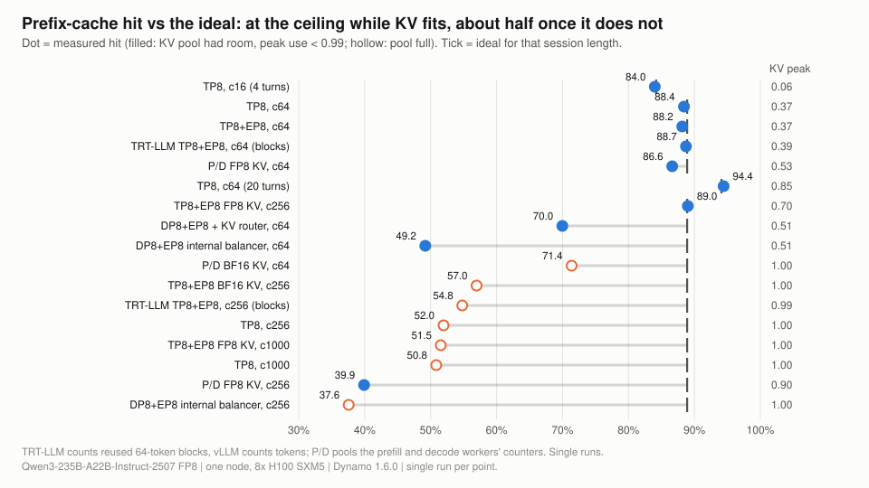

# Figures

**What you get from this page:** every figure and animation in one place, what each one shows, and how to regenerate them.

## The answer

All figures are plain SVG generated from [data/](../data/) with stdlib Python, so they can be rebuilt and audited:

```bash
python3 scripts/figures/make_figures.py      # figures/f0*.svg
python3 scripts/figures/make_animations.py   # figures/anim/a0*.svg
```

Each SVG carries an accessible `<title>` and `<desc>`, a comment listing the data files it reads, a light and a dark palette (`prefers-color-scheme`), and, for animations, a static summary state under `prefers-reduced-motion`. Conventions: **p90 is the headline percentile** (thin bars span p50 to p99 where shown); tok/s per user = 1000 / ITL p90; a hollow marker or bar means the run stopped at its time cap, so its latency is a lower bound (except in the frontier animation a06, where hollow means the point does not meet the target: fewer than 90% of its requests had TTFT &le; 2 s and mean ITL &le; 50 ms); the dashed red line is the target (TTFT 2 s, ITL 50 ms). Shapes in animations (KV cells, queues, step boxes) are schematic; every number is measured.

## Index

| File | What it shows | Used on |
|---|---|---|
| [f01-latency-vs-sessions.svg](f01-latency-vs-sessions.svg) | TTFT p90 and ITL p90 from 16 to 1,000 sessions, three layouts | README, [02](../docs/02-load-ladder-and-kv-cliff.md) |
| [f02-throughput-and-goodput.svg](f02-throughput-and-goodput.svg) | output tok/s per GPU and goodput per GPU vs sessions | [02](../docs/02-load-ladder-and-kv-cliff.md) |
| [f03-prefix-hit-vs-ideal.svg](f03-prefix-hit-vs-ideal.svg) | measured prefix-cache hit vs the ideal, every agentic point | below |
| [f04-kv-capacity-by-layout.svg](f04-kv-capacity-by-layout.svg) | KV pool by layout vs 256-session demand | README, [01](../docs/01-layouts-and-kv-capacity.md) |
| [f05-vllm-vs-trtllm.svg](f05-vllm-vs-trtllm.svg) | TTFT p90 and ITL p90, vLLM vs TensorRT-LLM, four points | [03](../docs/03-vllm-vs-tensorrt-llm.md) |
| [f06-pd-vs-aggregated.svg](f06-pd-vs-aggregated.svg) | aggregated vs P/D: TTFT p90, ITL p90, output per GPU | [05](../docs/05-prefill-decode-disaggregation.md) |
| [f07-kv-transfer-cost.svg](f07-kv-transfer-cost.svg) | KV hand-off size and time per transfer in P/D | [05](../docs/05-prefill-decode-disaggregation.md) |
| [f08-per-turn-latency-at-1000.svg](f08-per-turn-latency-at-1000.svg) | TTFT p90 and ITL p90 by turn at 1,000 sessions | [02](../docs/02-load-ladder-and-kv-cliff.md) |
| [f09-knob-map.svg](f09-knob-map.svg) | which single change moves which metric | README, [06](../docs/06-operating-frontier-and-sizing.md) |
| [anim/a01-kv-cliff.svg](anim/a01-kv-cliff.svg) | the KV pool filling from 64 to 256 sessions | [02](../docs/02-load-ladder-and-kv-cliff.md) |
| [anim/a02-dp-scatter-vs-kv-router.svg](anim/a02-dp-scatter-vs-kv-router.svg) | data-parallel balancer vs Dynamo KV router | [01](../docs/01-layouts-and-kv-capacity.md) |
| [anim/a03-agg-step-vs-pd.svg](anim/a03-agg-step-vs-pd.svg) | aggregated engine steps vs P/D steps | [05](../docs/05-prefill-decode-disaggregation.md) |
| [anim/a04-moe-block-refinement.svg](anim/a04-moe-block-refinement.svg) | why pure TP8 runs an untuned MoE kernel | [01](../docs/01-layouts-and-kv-capacity.md) |
| [anim/a05-session-growth.svg](anim/a05-session-growth.svg) | prompts growing per turn and the mid-session cliff at 256 sessions | README, [02](../docs/02-load-ladder-and-kv-cliff.md), [04](../docs/04-fp8-kv-cache.md) |
| [anim/a06-operating-frontier.svg](anim/a06-operating-frontier.svg) | the measured throughput vs per-user-speed frontier | README, [06](../docs/06-operating-frontier-and-sizing.md) |

<p align="center">

</p>

> <sub><i>The prefix cache delivers all the reuse an agent workload allows until the pool fills; after that it delivers about half.</i></sub>

## What to do with it

Change a figure by editing its generator and rerunning it, never by hand-editing the SVG; then validate with `xmllint --noout figures/*.svg figures/anim/*.svg`.
